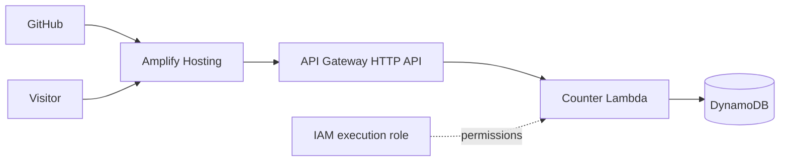

# Amplify Portfolio Hosting and Serverless Page Views

Public portfolio for malvernvito.com, with an approximate page-view counter. The existing page is reused; visitors do not sign in.

**Status: implemented and locally tested. Not deployed; DNS and existing greeting.meldit.net hosting have not changed.**

[Portfolio home](../../README.md) · [Architecture](docs/architecture/overview.md) · [Deployment](docs/deployment.md) · [Security and cost](docs/security-and-cost.md) · [Validation](docs/evidence/validation.md)

## Architecture



The browser records a view using POST /views and receives the aggregate count. GET /views reads it without incrementing. No identity, IP address, cookie, fingerprint or event history is persisted by the application. Infrastructure services may keep operational metadata.

The number is approximate: refreshes, bots and repeated requests can increase it. CORS and throttling are not authentication or bot-proof analytics. The portfolio remains usable if the counter is unavailable.

## Layout

| Path | Responsibility |
|---|---|
| website/ | Existing HTML and independent counter script |
| backend/counter/ | Python Lambda handler |
| terraform/modules/hosting/ | Imported Amplify app/branch and builds |
| terraform/modules/domain/ | Optional custom-domain association and explicit DNS ownership |
| terraform/modules/database/ | On-demand counter table |
| terraform/modules/iam/ | Scoped Lambda permissions |
| terraform/modules/api/ | Public HTTP API, Lambda and log groups |
| terraform/modules/monitoring/ | Alarms, dashboard and optional notifications |
| terraform/environments/production/ | Module wiring and separate state |
| tests/ | Backend contract tests and frontend fallback tests |

## Local checks

From this project folder, with Python 3.12+, Node.js and Terraform:

```powershell
python -m unittest discover -s tests -p "test_*.py"
node --test tests/counter.test.mjs
node scripts/build-website.mjs
python scripts/package-lambda.py
terraform fmt -check -recursive terraform
terraform -chdir=terraform/environments/production init -backend=false
terraform -chdir=terraform/environments/production validate
terraform -chdir=terraform/environments/production test
```

The tests use an in-memory table double, not DynamoDB. Terraform tests mock AWS. These checks are not deployment evidence.

To build with a real deployed API, set COUNTER_API_URL to its HTTPS origin, then rerun the website build. The public API URL is configuration, not a secret. Without it, the counter displays Unavailable and the rest of the page works.

## AWS Services — Chosen and Why

| Service | Why Chosen | Alternative Considered | Tradeoff |
|---|---|---|---|
| Amplify Hosting | Static portfolio delivery and Git-based releases | Existing S3/CloudFront site | Managed build/domain workflow; GitHub connection and build settings still require care |
| API Gateway HTTP API | Small public read/increment endpoints | Lambda function URL | Explicit routes, CORS and throttling; added service configuration and request charges |
| Lambda | Short counter logic without a running server | Container service | Minimal runtime management; cold starts and execution limits; no VPC dependency |
| DynamoDB | Durable atomic aggregate with on-demand capacity | Relational database | Fits one-key access; deliberately approximate, not exactly-once analytics |
| IAM | Table-scoped backend permissions | Broad managed permissions | More explicit policy work; no credentials or visitor sign-in in the browser |

## Deployment boundaries

No workflow automatically applies Terraform. Auto-build and custom-domain switches default off. The hosting module protects the Amplify app against accidental destruction; table deletion protection defaults on.

GitHub connection is a prerequisite: authorize the Amplify GitHub App, then import its app/branch into Terraform. No GitHub token is accepted in this Terraform configuration. Follow the staged [deployment runbook](docs/deployment.md) before any apply.

The old site, domain registration and hosted zones are not owned by this project. Custom-domain cutover is a separate reviewed step.
