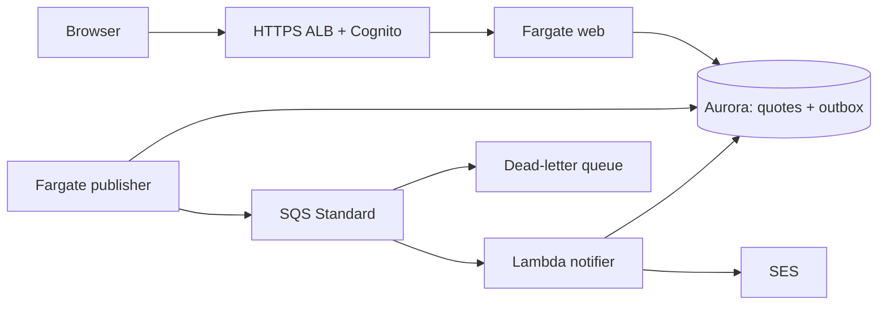
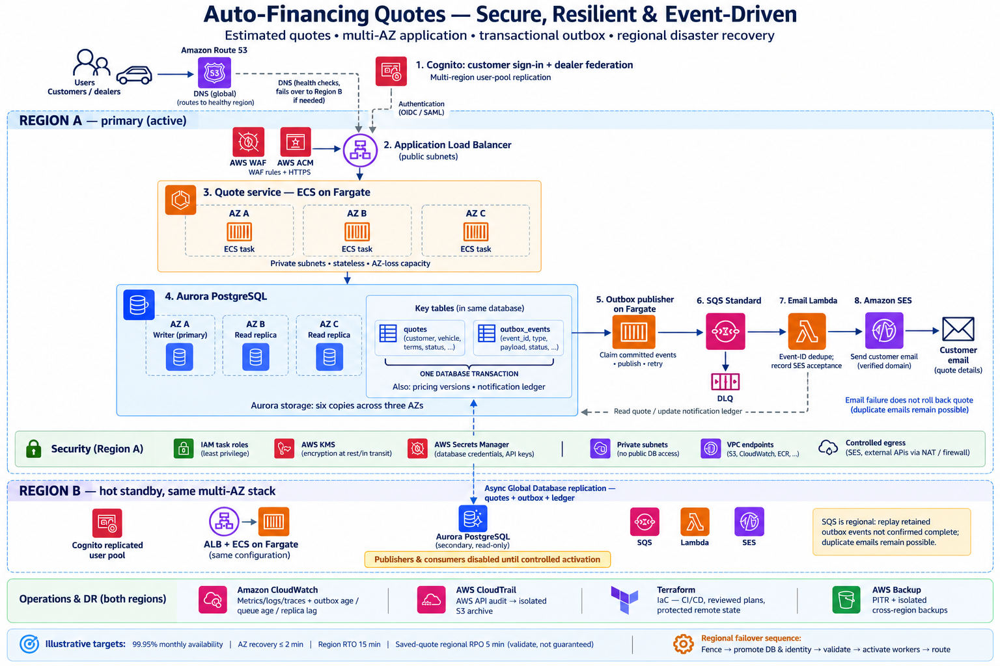

# Auto-Financing Quotes Platform

A working estimated-financing application demonstrating reliable persistence, asynchronous notifications and AWS architecture tradeoffs.

**Design focus:** commit a quote and notification intent atomically; recover messaging failures while the saved quote remains available.

[Architecture](docs/architecture/overview.md) · [Service choices](#aws-services--chosen-and-why) · [Deploy](docs/deployment/aws.md) · [Demo](docs/demo/walkthrough.md) · [Evidence](docs/evidence/README.md) · [Documentation](docs/README.md)


[Portfolio home](../../README.md) · [Case-study index](../README.md)

Commands below run from `Architecture-case-studies/auto-financing-quotes-platform/`. CI workflows live at the portfolio root.

## Run locally

Python 3.12+; local mode uses the standard library and SQLite.

```powershell
python -m app.server
```

Open http://127.0.0.1:8080 or run `./scripts/local/start.ps1`. Identity, queue, inbox and failure controls are simulations. Data lives in ignored `data/quotes.db`.

## Architecture

### Implemented single-region flow



- Atomic quote/outbox writes and owner-scoped idempotency.
- Worker leases, stable event IDs and bounded retry/backoff.
- Partial SQS batch failures, DLQ and notification ledger.
- Signed ALB identity validation, private compute/database, IAM and Secrets Manager.
- CloudWatch logs/metrics/alarms/dashboard and CloudTrail management events.

SES acceptance is not delivery. A crash before ledger commit can still duplicate email.

### Target multi-region architecture

**Target design, not the deployed demo topology.** The verified AWS exercise used one region and the cost-reduced demo profile. Region B, cross-region database/identity replication and isolated cross-region backups shown below remain roadmap items. Availability and RTO/RPO figures are illustrative objectives, not measured results.

[](docs/architecture/diagrams/target-architecture.pdf)

[Open the diagram as PDF](docs/architecture/diagrams/target-architecture.pdf) · [Architecture details and diagram caveats](docs/architecture/overview.md) · [Regional DR roadmap](docs/operations/recovery-roadmap.md)

## Regional profiles

| Property | Demo | HA |
|---|---|---|
| Regions / network AZs | 1 / 2 | 1 / 3 |
| Aurora instances | 1 | 3 |
| Initial web tasks / publishers | 1 / 1 | 3 / 2 |
| NAT gateways | 1 shared | 1 per AZ |
| Regional DR | Roadmap | Roadmap |

HA expands the same stack/state. Redundancy still requires capacity/failure testing.

## AWS Services — Chosen and Why

These choices describe the Terraform-managed application and its separate state bootstrap. The demo was deployed, verified and torn down; bootstrap was retained. Alternatives are architectural comparisons, not claims that every option was implemented or benchmarked.

### Traffic and HTTPS

| Service | Why Chosen | Alternative Considered | Tradeoff |
| --- | --- | --- | --- |
| **Amazon Route 53** | Resolve the application's domain to the ALB and manage ACM DNS validation records. | External DNS provider | Keeps DNS and certificate validation in the AWS deployment; requires hosted-zone access. The current app uses a single-region alias, not latency-based or regional failover routing. |
| **Application Load Balancer** | Route HTTPS requests to private Fargate tasks, check target health and integrate with Cognito login. | API Gateway with a Lambda-based API; NLB for transport-level balancing | Fits the existing HTTP/WSGI container and managed login flow. Has an always-on cost; `/healthz` proves liveness rather than a successful database-backed business transaction. |
| **AWS Certificate Manager** | Provision the public TLS certificate used by the ALB through DNS validation. | Operator-managed certificate lifecycle | Reduces certificate-management work, but validation and renewal still depend on retaining the required DNS records. The regional ALB certificate does not establish a second-region endpoint. |
| **AWS WAF** | Associate managed common rules and IP-based rate limiting with the ALB. | Application-only rate limiting; an external WAF | Adds an edge-layer filter and operational cost. Rules need tuning; WAF does not replace identity checks, owner-scoped authorization or secure application code. |

### Compute and Container Delivery

| Service | Why Chosen | Alternative Considered | Tradeoff |
| --- | --- | --- | --- |
| **Amazon ECS on AWS Fargate** | Run the existing web container, continuous outbox publisher and one-off migration task without operating EC2 hosts. | ECS on EC2; API Gateway/Lambda redesign | Preserves the Python WSGI application and separates worker lifecycles. Continuously running tasks incur idle cost; a serverless redesign would change the runtime and publication approach. |
| **Amazon ECR** | Store immutable application and notifier image tags with IAM-controlled push/pull and scan-on-push configuration. | Docker Hub or GHCR for the ECS image | Integrates with AWS workload roles. Lambda container images still require ECR in the function's region. Immutable releases require fresh tags; scanning is configured but is not an enforced release gate. |
| **AWS Lambda** | Consume SQS batches independently of the web tier and report individual failed records for retry. | Dedicated Fargate notification worker | Avoids another continuously polling notifier service, but needs idempotent handling and bounded concurrency. VPC networking introduces cleanup dependencies, observed during teardown. |

### Relational Data and Consistency

| Service | Why Chosen | Alternative Considered | Tradeoff |
| --- | --- | --- | --- |
| **Amazon Aurora PostgreSQL** | Persist quotes, outbox events and notification ledger records with relational constraints and transactional quote/outbox writes. | RDS for PostgreSQL; DynamoDB transactions and Streams | Fits SQL transactions and the existing ownership model, but carries an idle-cost floor and connection-management responsibilities. The demo had one DB instance; the three-instance HA profile and regional recovery were not failure-tested. |

The outbox addresses the database-to-message dual-write problem. It does not make the later SES send atomic with the ledger update. Aurora Global Database and RDS Proxy were not deployed in this exercise.

### Messaging and Email

| Service | Why Chosen | Alternative Considered | Tradeoff |
| --- | --- | --- | --- |
| **Amazon SQS Standard** | Buffer notifications and decouple quote persistence from asynchronous email processing; strict event ordering is unnecessary here. | SQS FIFO; direct synchronous email sending | Standard delivery can duplicate or reorder messages, so consumers use stable event IDs and a ledger. FIFO would add ordering/deduplication features but would not make the SES side effect exactly once. |
| **SQS Dead-Letter Queue** | Retain repeatedly unsuccessful queue messages for inspection and controlled redrive after five receive attempts. | Retry in the source queue until message expiry | Makes poison messages visible, but requires monitoring, diagnosis and deliberate redrive. A DLQ cannot recover an outbox event that never reached SQS. Actual redrive behavior was not exercised in AWS. |
| **Amazon SES** | Send an authenticated user's notification with a protected application link instead of financial details. | External transactional email provider | Uses AWS IAM and regional email configuration, but sender/recipient eligibility, reputation and deliverability need attention. The test email arrived in spam before the user moved it to the inbox; acceptance is not proof of inbox placement. |

### Network Boundaries and Egress

| Service | Why Chosen | Alternative Considered | Tradeoff |
| --- | --- | --- | --- |
| **Amazon VPC and Security Groups** | Keep compute/database in private subnets, allow web ingress from the ALB and restrict PostgreSQL access to the compute group. | Publicly addressed application tasks | Provides explicit ingress and database boundaries, with additional routing and troubleshooting work. Runtime components currently share a compute security group rather than separate per-worker groups. |
| **NAT Gateway** | Let private workloads reach required public AWS service endpoints without public task IP addresses. | Broader interface-endpoint coverage; public task networking | Straightforward outbound access, but adds recurring and traffic-related cost. Demo uses one shared NAT, a zonal dependency; HA provisions one per AZ. |
| **S3 Gateway VPC Endpoint** | Give private-subnet S3 traffic a gateway-endpoint route. | Route S3 traffic through NAT | Avoids that NAT path for S3, but covers only S3. The diagram's broader endpoint set is not implemented; SQS, Secrets Manager and other calls still rely on their configured egress paths. |

### Identity, Secrets and Encryption

| Service | Why Chosen | Alternative Considered | Tradeoff |
| --- | --- | --- | --- |
| **Amazon Cognito** | Provide managed customer sign-in and verified email identity through ALB authentication. | Direct external OIDC integration; application-managed authentication | Reduces authentication implementation work. The app must still validate ALB signatures and enforce owner authorization. Cross-region identity replication and dealer federation remain design work. |
| **AWS IAM and GitHub OIDC** | Give workloads temporary role credentials and let the GitHub image workflow assume a repository/branch-restricted role. | Stored AWS access keys for CI | Avoids long-lived CI keys but requires correct trust claims and narrowly scoped permissions. The image-push role does not deploy Terraform; workload policies still need review, including network-interface cleanup permissions. |
| **AWS Secrets Manager** | Retrieve the runtime database credential using task/Lambda roles and keep admin access in the migration path. | Parameter Store SecureString; deployment-time secret injection | Centralizes retrieval and access controls, with API/service cost and caching behavior. Runtime components share a DB role; application-password rotation is not automated. Generated credentials also exist in private Terraform state. |
| **AWS KMS** | Encrypt the separate Terraform state bucket with a customer-managed key and an explicit access boundary. | S3-managed encryption for state | Gives additional control over state-key access and lifecycle, but key permissions and retained-key cost must be managed. This does not imply customer-managed KMS keys were configured for every application service. |

### Observability, Audit and Cost Control

| Service | Why Chosen | Alternative Considered | Tradeoff |
| --- | --- | --- | --- |
| **Amazon CloudWatch** | Collect application/service logs, outbox metrics, backlog/error alarms and a common dashboard. | External observability platform | Integrates with deployed AWS services but introduces ingestion, retention and monitoring costs. Dashboard/alarm configuration was verified; alarm transitions, distributed tracing and load objectives were not tested. |
| **AWS CloudTrail** | Record management API activity and help diagnose deployment/IAM problems. | Organization-wide centralized audit deployment | Supplies infrastructure audit evidence, not quote-row history or all messaging data events. The current audit bucket is in the sandbox account, not an isolated immutable archive. |
| **Amazon S3** | Store versioned remote Terraform state in bootstrap and CloudTrail objects in a separate audit bucket. | Local-only state; a managed Terraform backend | Supports shared state with locking configuration and durable object storage, but requires strict access and separate retention policies. State is private; audit `force_destroy` permits deletion during teardown. Neither bucket serves the quote application's frontend. |
| **Amazon SNS** | Give CloudWatch alarms a notification destination with optional email subscription. | External incident-management integration | Simple AWS-native notification plumbing; a subscription must be configured and confirmed. This project does not demonstrate staffed escalation or alert-delivery testing. |
| **AWS Budgets** | Define a Project-tag-filtered spending threshold and optional notification recipient for sandbox cost awareness. | Manual billing review; external FinOps tooling | Helpful for visibility but not a spending cap. Billing/alert delays and cost-tag activation matter; the configured amount is not a measured project cost or guaranteed maximum bill. |

CloudFront belongs to the separate portfolio website, not the quote application's request path. Shield Advanced, ElastiCache, an AWS Backup deployment and a secondary AWS region are not part of the verified app stack.

### Supporting Decision Records and References

The reasoning above is tied to [transactional outbox](docs/architecture/decisions/001-transactional-outbox.md), [managed services](docs/architecture/decisions/002-managed-services.md), [deployment boundaries](docs/architecture/decisions/003-deployment-boundaries.md) and the [live verification record](docs/evidence/dated-exercises/2026-10-29-live-verification/README.md).

Relevant AWS service behavior: [ALB authentication](https://docs.aws.amazon.com/elasticloadbalancing/latest/application/listener-authenticate-users.html), [SQS delivery semantics](https://docs.aws.amazon.com/AWSSimpleQueueService/latest/SQSDeveloperGuide/standard-queues.html), [Lambda partial batch responses](https://docs.aws.amazon.com/lambda/latest/dg/services-sqs-errorhandling.html), [Lambda container images](https://docs.aws.amazon.com/lambda/latest/dg/images-create.html), [Fargate charging model](https://aws.amazon.com/ecs/pricing/), [Secrets Manager rotation](https://docs.aws.amazon.com/secretsmanager/latest/userguide/rotate-secrets_lambda.html) and [budget notification limits](https://docs.aws.amazon.com/cost-management/latest/userguide/budgets-managing-costs.html).

## Repository map

| Path | Purpose |
|---|---|
| app/, web/ | Python API, workers, Lambda and buildless UI |
| migrations/, tests/ | Initial schema and reliability/authentication tests |
| infra/bootstrap/ | State storage and GitHub OIDC |
| infra/stacks/regional/ | Deployable regional Terraform |
| containers/ | Fargate/Lambda image definitions |
| scripts/ | Local startup, deployment and repository checks |
| docs/ | Architecture, decisions, deployment, operations, evidence |

## Validate

```powershell
python -m venv .venv
.venv/Scripts/python.exe -m pip install -r requirements-dev.txt
.venv/Scripts/python.exe -m pytest -q
python scripts/verify-repository.py
node --check web/app.js
terraform fmt -check -recursive infra
terraform -chdir=infra/bootstrap init -backend=false
terraform -chdir=infra/bootstrap validate
terraform -chdir=infra/stacks/regional init -backend=false
terraform -chdir=infra/stacks/regional validate
terraform -chdir=infra/stacks/regional test
```

Terraform tests mock providers; application tests use SQLite. Neither proves AWS failover, PostgreSQL concurrency, throughput or recovery objectives.

## Evidence and scope

The [live AWS exercise](docs/evidence/dated-exercises/2026-10-29-live-verification/README.md) verified Cognito sign-in, quote save/read, an idempotent sequential retry, event publication, SES acceptance and recipient-confirmed email receipt. The message initially went to spam and was moved to the inbox by the user.

The regional demo stack was torn down after evidence capture; the app is no longer hosted. Bootstrap/state storage was preserved. These observations came from the existing standalone deployment, not a second stack created from this portfolio folder. See [all evidence and limitations](docs/evidence/README.md), including the [earlier deployment record](docs/evidence/dated-exercises/2026-10-29-demo-deployment.md) and [historical source record](docs/evidence/source-project-verification.md).

Regional DR remains a [future implementation](docs/operations/recovery-roadmap.md). No production availability, scale or recovery objective is claimed. Estimates are illustrative, not underwriting, credit scoring or financing offers.

## Deploy deliberately

The new default project name is drivequote-portfolio. Configure new DNS, state and GitHub identity. Do not reuse the original deployment state.

Read [deployment](docs/deployment/aws.md), [security](docs/security/security.md), [cost](docs/cost/cost-model.md) and [teardown](docs/operations/teardown.md). Release sequence: foundation/runtime off → images → migration → runtime on. No workflow applies Terraform.

Always-on Aurora, ALB, NAT and Fargate incur charges; budget alerts are not caps.
