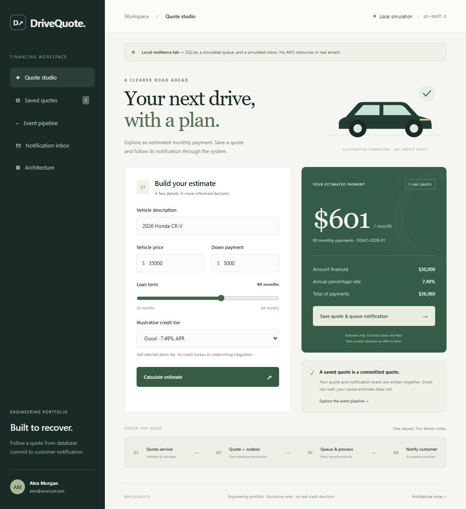
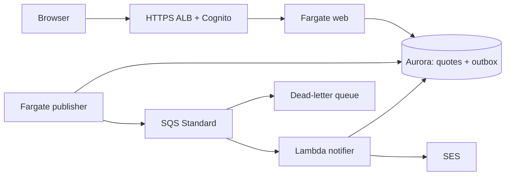

# Auto-Financing Quotes Platform

A working estimated-financing application demonstrating reliable persistence, asynchronous notifications and AWS architecture tradeoffs.

**Design focus:** commit a quote and notification intent atomically; recover messaging failures while the saved quote remains available.

[Architecture](docs/architecture/overview.md) · [Deploy](docs/deployment/aws.md) · [Demo](docs/demo/walkthrough.md) · [Evidence](docs/evidence/README.md) · [Documentation](docs/README.md)



[Portfolio home](../../README.md) · [Case-study index](../README.md)

Commands below run from `Architecture-case-studies/auto-financing-quotes-platform/`. CI workflows live at the portfolio root.

## Run locally

Python 3.12+; local mode uses the standard library and SQLite.

```powershell
python -m app.server
```

Open http://127.0.0.1:8080 or run `./scripts/local/start.ps1`. Identity, queue, inbox and failure controls are simulations. Data lives in ignored `data/quotes.db`.

## Architecture



- Atomic quote/outbox writes and owner-scoped idempotency.
- Worker leases, stable event IDs and bounded retry/backoff.
- Partial SQS batch failures, DLQ and notification ledger.
- Signed ALB identity validation, private compute/database, IAM and Secrets Manager.
- CloudWatch logs/metrics/alarms/dashboard and CloudTrail management events.

SES acceptance is not delivery. A crash before ledger commit can still duplicate email.

## Regional profiles

| Property | Demo | HA |
|---|---|---|
| Regions / network AZs | 1 / 2 | 1 / 3 |
| Aurora instances | 1 | 3 |
| Initial web tasks / publishers | 1 / 1 | 3 / 2 |
| NAT gateways | 1 shared | 1 per AZ |
| Regional DR | Roadmap | Roadmap |

HA expands the same stack/state. Redundancy still requires capacity/failure testing.

## Repository map

| Path | Purpose |
|---|---|
| app/, web/ | Python API, workers, Lambda and buildless UI |
| migrations/, tests/ | Initial schema and reliability/authentication tests |
| infra/bootstrap/ | State storage and GitHub OIDC |
| infra/stacks/regional/ | Deployable regional Terraform |
| containers/ | Fargate/Lambda image definitions |
| scripts/ | Local startup, deployment and repository checks |
| docs/ | Architecture, decisions, deployment, operations, evidence |

## Validate

```powershell
python -m venv .venv
.venv/Scripts/python.exe -m pip install -r requirements-dev.txt
.venv/Scripts/python.exe -m pytest -q
python scripts/verify-repository.py
node --check web/app.js
terraform fmt -check -recursive infra
terraform -chdir=infra/bootstrap init -backend=false
terraform -chdir=infra/bootstrap validate
terraform -chdir=infra/stacks/regional init -backend=false
terraform -chdir=infra/stacks/regional validate
terraform -chdir=infra/stacks/regional test
```

Terraform tests mock providers; application tests use SQLite. Neither proves AWS failover, PostgreSQL concurrency, throughput or recovery objectives.

## Evidence and scope

The [live AWS exercise](docs/evidence/dated-exercises/2026-10-29-live-verification/README.md) verified Cognito sign-in, quote save/read, an idempotent sequential retry, event publication, SES acceptance and recipient-confirmed email receipt. The message initially went to spam and was moved to the inbox by the user.

The regional demo stack was torn down after evidence capture; the app is no longer hosted. Bootstrap/state storage was preserved. These observations came from the existing standalone deployment, not a second stack created from this portfolio folder. See [all evidence and limitations](docs/evidence/README.md), including the [earlier deployment record](docs/evidence/dated-exercises/2026-10-29-demo-deployment.md) and [historical source record](docs/evidence/source-project-verification.md).

Regional DR remains a [future implementation](docs/operations/recovery-roadmap.md). No production availability, scale or recovery objective is claimed. Estimates are illustrative, not underwriting, credit scoring or financing offers.

## Deploy deliberately

The new default project name is drivequote-portfolio. Configure new DNS, state and GitHub identity. Do not reuse the original deployment state.

Read [deployment](docs/deployment/aws.md), [security](docs/security/security.md), [cost](docs/cost/cost-model.md) and [teardown](docs/operations/teardown.md). Release sequence: foundation/runtime off → images → migration → runtime on. No workflow applies Terraform.

Always-on Aurora, ALB, NAT and Fargate incur charges; budget alerts are not caps.
