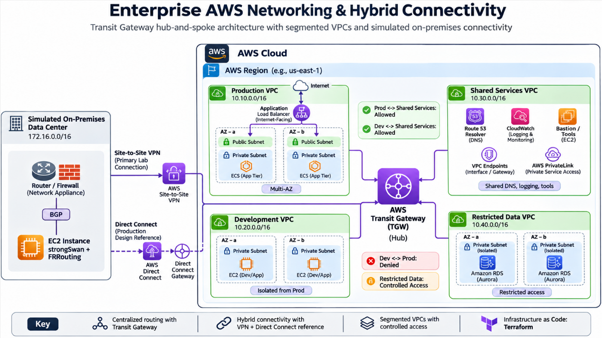
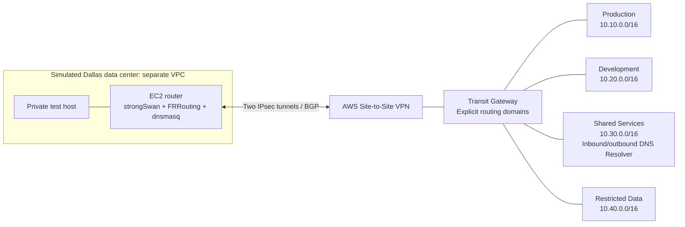

# Enterprise Hybrid Network

[Portfolio home](../../README.md) | [Architecture case studies](../README.md)

**Status:** deployed and tested in AWS us-east-1 on November 6, 2026, then destroyed with cleanup independently verified. **VPN interruption recovery remains unresolved.** This is a single-account financial-services migration lab, not a production bank deployment.

## Business use case

A fictional financial institution is moving a Dallas data center to AWS over 12-18 months. Production, Development, Shared Services and Restricted Data need distinct routing boundaries while approved workloads retain access to the simulated data center. The design demonstrates migration coexistence without buying a physical Direct Connect circuit.

## Results at a glance

| Outcome | Evidence and qualification |
| --- | --- |
| Segmentation | 81/81 TCP source/destination checks matched policy across nine known listeners, including both AWS AZs and local positive controls |
| Hybrid connectivity | Two IPsec/BGP tunnels; Production/Shared exchanged traffic with the on-premises test host |
| Hybrid DNS | AWS and private-client queries passed; a VTI source-address defect was corrected in dnsmasq and its bootstrap template |
| Observability | Four active VPC flow logs; actual CloudWatch records retained in sanitized evidence |
| Resilience gap | Both tunnel interruptions produced failed TCP/DNS probes; automatic rejoin and a repeatable recovery measurement remain unfinished |
| Cost control | All 162 Terraform resources destroyed; direct AWS checks confirmed no lab resources remained |

Read the [dated validation report](docs/live-validation-2026-11-06.md) for sample counts, timestamps, controls and limitations. The 81 checks include self/local controls; they are not 81 independent end-to-end business scenarios. Failed probes alone do not distinguish SG denial from missing routes.

## Architecture



Conceptual architecture reference supplied for the portfolio. ALB/ECS, public workload subnets, Aurora, bastion, shared PrivateLink and Direct Connect illustrate design options and were not deployed in this lab. The tested implementation uses private EC2 listeners, SSM endpoints, VPN/BGP and Resolver endpoints; see the dated validation evidence.



Lines represent attachments, not unrestricted access. The simulated data center has no direct TGW VPC attachment; hybrid traffic must traverse the VPN. Two tunnels share one EC2 router and do not establish router/site resilience. Direct Connect is a documented production option using transit VIFs, not a purchased or tested service.

## Explore the case study

| Topic | Read |
| --- | --- |
| Business problem, ownership and success criteria | [Executive brief](docs/portfolio/executive-brief.md) |
| CIDRs, allowed paths and production considerations | [Architecture](docs/architecture.md) |
| Alternatives and consequences | [Architecture decisions](docs/portfolio/decisions.md) and [trade-offs](docs/portfolio/trade-offs.md) |
| What ran and what did not pass | [Evidence register](docs/evidence/README.md) and [live report](docs/live-validation-2026-11-06.md) |
| Find each Terraform resource | [Resource map](docs/terraform-resource-map.md) |
| Reproduce and troubleshoot | [VPN runbook](docs/hybrid-runbook.md), [DNS guide](docs/hybrid-dns.md), [validation plan](docs/validation-plan.md) |

## Implementation and ownership

The portfolio implementation covers the address plan, native Terraform VPC/TGW modules, explicit routing policy, simulated customer router bootstrap, selective BGP propagation, private SSM access, TCP test listeners, hybrid DNS and evidence collection. AWS manages the TGW, VPN and Resolver services. The financial scenario is illustrative; regulatory certification, customer use and business ROI are not claimed.

| Code group | Purpose |
| --- | --- |
| `c3-*` | AZ selection |
| `c4-*` | Four two-AZ VPCs and their subnets/route tables |
| `c5-*` | TGW, attachments, routing domains and approved routes |
| `c6-*` | Flow logs and delivery IAM |
| `c7-*` | Simulated data center, router, customer gateway, VPN/BGP |
| `c8-*` | Test-host IAM/security, SSM endpoints and instances |
| `c9-*` | DNS security, Resolver endpoints, zone and forwarding |

Numbers provide reading order. Terraform dependencies control creation order. All resources belong to one independent lab root/state; module files are split by resource purpose.

## Reproduce locally

Prerequisites: Terraform >=1.7 and <2, AWS CLI, and an isolated lab account for deployment. Local mocked tests need no AWS credentials.

```powershell
Set-Location terraform/environments/lab
Copy-Item terraform.tfvars.example terraform.tfvars
terraform init -backend=false
terraform fmt -check -recursive ../..
terraform validate
terraform test
```

To plan the full lab, set `enable_hybrid`, `enable_test_hosts` and `enable_hybrid_dns` to `true` in local tfvars. Defaults are false. Check for existing local `*.auto.tfvars` files, which override ordinary tfvars. The live session required room for five new VPCs and 20 Standard On-Demand vCPUs; include existing account usage when checking quotas.

```powershell
aws sts get-caller-identity
terraform plan -out=lab.tfplan
terraform show lab.tfplan
# Apply only after reviewing account, region, quotas, resources and costs.
terraform apply lab.tfplan
```

Keep state, saved plans, VPN secrets, credentials, local tfvars and raw logs private. The provider lock file is committed source; `.terraform/` is generated cache. The lock currently includes the Windows provider checksum; initialize on the target platform to populate its checksum before enforcing a read-only lock there.

## Operational limits and remaining work

- Improve IPsec/BGP rejoin behavior and repeat each interruption with a stable baseline and bounded restoration. No proven RTO, zero-loss or automatic recovery claim.
- Recreate and verify the corrected DNS bootstrap from a clean deployment; the original running router was patched during testing.
- Capture AWS console screenshots during a future explicitly scheduled session. No screenshots have been fabricated or collected for this case study.
- Multi-account controls, redundant customer routers/sites, production DNS resilience, throughput/MTU tests and compliance assurance are outside this exercise.

The test session used a $5 spending target, not a hard spending cap or a measured bill. Endpoint/TGW/VPN costs continue while resources exist. Screenshot sessions must remain running until the owner explicitly authorizes teardown. After authorization, use `terraform destroy` from this root, preserve evidence first, and verify AWS cleanup.
