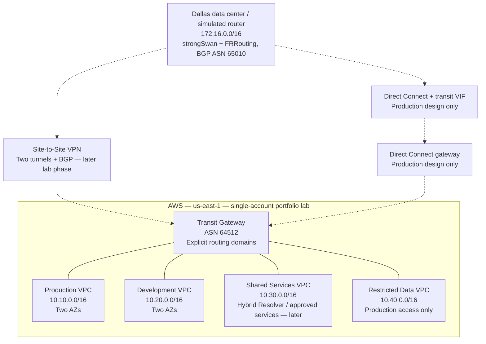

# Enterprise Hybrid Network architecture

> Live-session update: the full lab was deployed and tested on November 6, 2026. See [observed results and cleanup status](live-validation-2026-11-06.md); failover recovery remains unfinished. Earlier pending-status text below describes the predeployment baseline.

Recreated from the supplied four-VPC plan; this is a logical diagram, not the recovered original image or an AWS-icon rendering. The four VPCs, Transit Gateway and segmented routes are implemented in Terraform but are not deployed. Optional hybrid connectivity is also implemented but untested; optional hybrid DNS is implemented but untested. See the hybrid runbook.

Lines show attachments, not unrestricted reachability. Dashed paths are later-phase hybrid connectivity. Region and ASNs are proposed lab defaults. The simulated router belongs in a separate VPC with `172.16.0.0/16`, a public subnet/EIP for the VPN outside address, and private prefixes advertised using BGP. It must not also attach directly to TGW and bypass the VPN test path.

## Address allocation

Workload subnets use /24s; dedicated attachment subnets use /28s. AZ A/B refers to the first two selected AZs, not necessarily literal account-independent AZ letters.

| Zone | VPC CIDR | Workload AZ A / B | TGW attachment AZ A / B |
| --- | --- | --- | --- |
| Production | 10.10.0.0/16 | 10.10.1.0/24 / 10.10.2.0/24 | 10.10.251.0/28 / 10.10.252.0/28 |
| Development | 10.20.0.0/16 | 10.20.1.0/24 / 10.20.2.0/24 | 10.20.251.0/28 / 10.20.252.0/28 |
| Shared services | 10.30.0.0/16 | 10.30.1.0/24 / 10.30.2.0/24 | 10.30.251.0/28 / 10.30.252.0/28 |
| Restricted data | 10.40.0.0/16 | 10.40.1.0/24 / 10.40.2.0/24 | 10.40.251.0/28 / 10.40.252.0/28 |
| Simulated on-premises | 172.16.0.0/16 | Reserve private test subnet 172.16.1.0/24 | No direct TGW VPC attachment |

## Phase 1–2 routing policy

The supplied design did not specify every permitted relationship. The following is a proposed least-access starting policy: production and development can use shared services; production can reach restricted data; development cannot reach production or restricted data; shared services cannot reach restricted data. Routes are bidirectional for permitted pairs. Security groups restrict service ports and initiators separately.

Associate each attachment with its own TGW route table. Disable TGW default association and propagation. Use explicit static VPC routes initially, with no broad `10.0.0.0/8` or default route to TGW.

| Ingress attachment / associated TGW table | Destination CIDR → attachment |
| --- | --- |
| Production / production | 10.30.0.0/16 → shared; 10.40.0.0/16 → restricted |
| Development / development | 10.30.0.0/16 → shared |
| Shared / shared | 10.10.0.0/16 → production; 10.20.0.0/16 → development |
| Restricted / restricted | 10.10.0.0/16 → production |

Create matching remote-prefix routes toward TGW in workload subnet route tables. Local VPC routes remain intact. Do not enable blanket propagation. No route to a forbidden prefix is the initial isolation mechanism; add explicit blackholes if later aggregate routes would otherwise introduce reachability. A TGW route table is not a firewall and does not enforce allowed application ports.

## Later hybrid phases

Start with on-premises access to production and shared services only. Add an explicit hybrid TGW table with those two destinations and on-premises return routes in the production/shared tables. Introduce VPN route propagation selectively for BGP-learned prefixes. Document route preference and test both tunnels before claiming failover. Two tunnels to one EC2 router demonstrate tunnel redundancy, not router or site resilience.

For production, show the data center router, Direct Connect circuit, transit virtual interface, Direct Connect gateway, and TGW association. Specify redundant connectivity separately; Direct Connect alone does not imply encryption. Document encryption requirements and route preferences rather than claiming the unbuilt circuit was tested.

Hybrid DNS needs inbound and outbound Route 53 Resolver endpoints, conditional forwarding rules, return routes, and TCP/UDP 53 security rules. Endpoints/PrivateLink need deliberate DNS and access policies; placing endpoints in shared services does not automatically share their private DNS with every spoke.

The initial lab omits NAT gateways and internet egress. Budget separately for TGW attachment hours/data processing, test hosts, flow logs, interface endpoints, Resolver endpoints, VPN and any egress resources when added. Multi-AZ subnets alone do not prove application resilience.

## References

- [AWS: Field Notes — How to Scale Your Networks](https://aws.amazon.com/blogs/architecture/field-notes-how-to-scale-your-networks-on-amazon-web-services/)
- [AWS: How Transit Gateway works](https://docs.aws.amazon.com/vpc/latest/tgw/how-transit-gateways-work.html)
- [AWS: Working with Route Tables in Transit Gateway](https://aws.amazon.com/blogs/architecture/field-notes-working-with-route-tables-in-aws-transit-gateway/)
