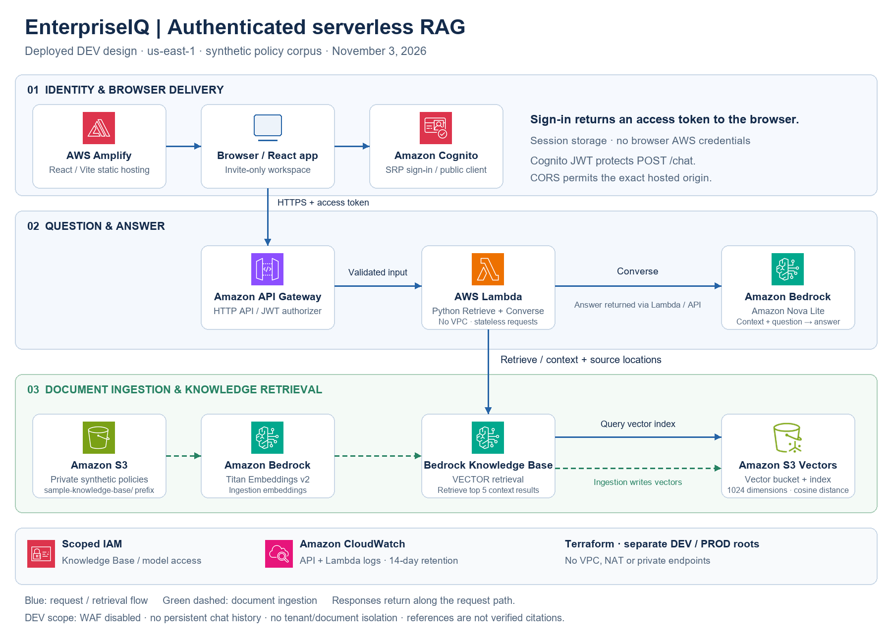
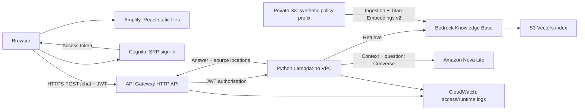

# Deployed DEV architecture

[Scalable SVG and editable source](diagrams/README.md). The AWS-icon diagram shows the same deployed DEV design as the Mermaid flow below.

## Request path

The browser signs in directly to Cognito with a public client and SRP. Tokens use browser session storage. API Gateway validates the access token issuer, audience and route scope before invoking Lambda. The client sends only the current question. Lambda retrieves context, generates an answer and returns answer/source JSON. Each API request creates a fresh conversation.

## Boundaries and controls

| Boundary | Implemented control | Limitation |
|---|---|---|
| Browser to API | HTTPS, Cognito JWT and explicit CORS origins | CORS is a browser control, not API authorization |
| API to Lambda | API Gateway invocation permission, validation and throttling | Shared Lambda concurrency; no strict per-user quota |
| Lambda to Bedrock | Knowledge Base and model-scoped IAM | No document-level permission filtering |
| Documents to retrieval | Private S3 and sample-knowledge-base/ ingestion prefix | Ingestion prefix is corpus selection, not tenant isolation |
| Runtime to logs | Limited error metadata; 14-day retention | Alarms and end-to-end monitoring are pending |

Standard networking creates no VPC, NAT gateways or private endpoints. Managed regional service endpoints are used. The app-specific WAF was removed for DEV cost control. DynamoDB is not in the deployed RAG path. PROD root definitions do not establish a production deployment or separate-account isolation.

## Source map

- [RAG service](../../backend/rag_service.py)
- [Lambda adapter](../../backend/lambda_handler.py)
- [API and Cognito Terraform](../../terraform/modules/chat_api/main.tf)
- [RAG Terraform](../../terraform/modules/rag/main.tf)
- [DEV hosting](../../terraform/environments/dev/frontend.tf)
- [React application](../../frontend/src/App.jsx)
