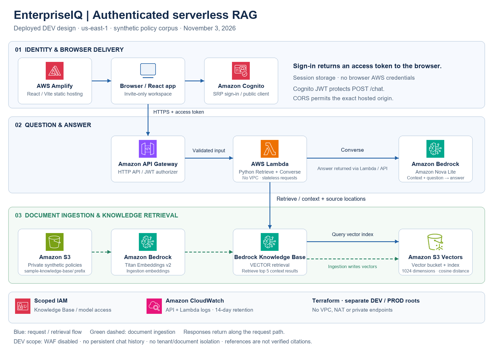

# EnterpriseIQ AWS architecture diagram

- [PNG](enterpriseiq-aws-architecture.png): high-resolution repository and presentation image.
- [SVG](enterpriseiq-aws-architecture.svg): scalable diagram with embedded icons; no external image requests.
- [Editable generator](render_architecture.py): layout, labels and connectors. Run `python -m pip install pillow`, then `python docs/portfolio/diagrams/render_architecture.py` from the project root.

This depicts the current DEV design, not a future production target. Blue arrows show requests/retrieval; dashed green arrows show ingestion. Responses return through the corresponding request path. The browser runs outside AWS; the shaded panels group workflows, not VPC or account boundaries. CloudWatch and IAM apply across the runtime even though their individual connections are omitted for readability.

Bedrock's service icon is reused for the Knowledge Base, Titan Embeddings v2 and Nova Lite; each is labeled by its role. The S3 Vectors resource icon identifies the vector store. No custom model-specific icons are implied. The logical ingestion sequence summarizes Knowledge Base orchestration rather than a direct S3-to-model API call.

## Icon provenance

Selected, unmodified service/resource icons are from the [official AWS Architecture Icons](https://aws.amazon.com/architecture/icons/) package, release July 31, 2026, downloaded November 3, 2026. AWS icons are owned by Amazon Web Services; their inclusion describes the services used and does not imply AWS endorsement.

Source archive: [AWS icon package](https://d1.awsstatic.com/onedam/marketing-channels/website/public/shared/architecture-icon-release/Icon-package_07312026.5846e92413caa21490223536cc97f1269e44fa92.zip). Only the nine required icons are retained in `icons/`; the full downloaded package is excluded from Git.

The diagram is architecture documentation, not evidence of load capacity, availability, quality metrics or production readiness. See the [evidence register](../evidence/README.md) for validation scope.
